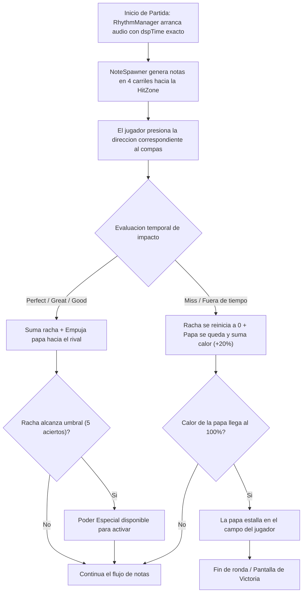

# Beat Potato (Papa Beat) - Game Design Document (GDD)

### Duelo Ritmico Arcade 1v1 y Solo vs CPU estilo Friday Night Funkin'

---

## Indice

1. Resumen Ejecutivo y Pitch
2. Objetivo del Juego
3. Pilares y Valores de Diseno
4. Referentes
5. Modos de Juego
6. Esquema de Controles y Mecanicas del Jugador
7. El Ciclo Principal de Juego (Core Loop)
8. Mecanicas del Juego
9. Sistema de Notas y Calificaciones (Hit Timing)
10. La Mecanica de la Papa: Traspaso, Calor y Explosion
11. Sistema de Rachas y Poderes Especiales
12. Arquitectura de Software en Unity
13. Interfaz de Usuario y Presentacion Visual
14. Plan de Desarrollo y Alcance para Game Jam (24 Horas)
15. Imagenes del Proceso
16. Datos Tecnicos
17. Preguntas de Playtest

---

## 1. Resumen Ejecutivo y Pitch

Beat Potato es un juego de ritmo arcade para dos jugadores en un mismo PC (con opcion de juego individual contra la maquina) que combina las mecanicas de 4 carriles de Friday Night Funkin' con la dinamica eliminatoria y tension de la papa caliente.

Una papa a punto de estallar viaja entre dos contrincantes al compas de la musica. Cada jugador cuenta con su propio panel de 4 carriles (Izquierda, Abajo, Arriba, Derecha) y debe presionar las teclas en el momento exacto en que las notas cruzan la zona de impacto (HitZone). Acertar con precision (Perfect, Great, Good) mantiene la papa en juego, la empuja hacia el campo rival y acumula rachas para desatar poderes de sabotaje. Cometer fallos (Miss) retiene la papa en el campo propio y eleva su nivel de calor hasta que explota en las manos del jugador.

> **Pitch de elevador:**
> Beat Potato es un duelo de ritmo arcade para dos jugadores en un mismo PC (con opcion individual contra la maquina) donde los rivales pulsan notas en cuatro carriles al compas de la musica. Mantener el ritmo y encadenar rachas permite desatar poderes de sabotaje y empujar una papa explosiva hacia el campo contrario antes de que se sobrecaliente y estalle.

> **Pitch oficial:**
> Friday Night Funkin' se fusiona con la Papa Caliente: pulsa las notas al compas de la musica, acumula rachas de aciertos para lanzar poderes y evita que la papa se sobrecaliente en tu lado antes de que te explote.

---

## 2. Objetivo del Juego

Sobrevivir al intercambio ritmico manteniendo rachas de aciertos para traspasar la papa al oponente hasta que se sobrecaliente al 100% y explote en su campo.

---

## 3. Pilares y Valores de Diseno

### Pilares de diseno

1. **Ritmo Accesible y Competitivo:**
   Mecanica de 4 direcciones intuitiva y directa, respaldada por un motor de audio de alta precision basado en `AudioSettings.dspTime` y ventanas de calificacion claras. La precision temporal y el oido musical determinan el exito de cada intercambio.
2. **Tension y Traspaso de la Papa Caliente:**
   El resultado no depende de un puntaje pasivo; la papa viaja fisicamente por la pantalla entre los dos jugadores como una amenaza constante visible. Los aciertos transfieren la presion al oponente; los fallos retienen la papa en el lado propio y aumentan su calor critico.
3. **Rachas y Sabotaje Estrategico:**
   Mantener cadenas de notas perfectas recompensa con poderes especiales de un solo uso para alterar la pantalla o notas del rival (velocidad aumentada, notas invisibles, distorsion), forzando su equivocacion, generando dinamismo y remontadas.
4. **Experiencia Local Compartida y Modo Solitario:**
   Disenado de forma nativa para que dos personas jueguen hombro a hombro en el mismo teclado fisico sin interferencias ni conflicto de teclas, integrando ademas una IA con niveles de dificultad configurables para partidas individuales.

### Valores de diseno

- **Justicia y Claridad Ritmica:** La musica es la fuente de verdad temporal absoluta; el acierto se juzga por el compas y no por fluctuaciones de rendimiento grafico.
- **Diversion Frenetica Arcade:** Partidas cortas, tensas y emocionantes de 60 a 90 segundos que inviten de inmediato a la revancha.

---

## 4. Referentes

### Gameplay

**Friday Night Funkin' / Dance Dance Revolution**

Toma el sistema de notas direccionales en cuatro carriles (Izquierda, Abajo, Arriba, Derecha) que caen hacia una zona de impacto fija, con clasificacion de precision temporal (Perfect, Great, Good, Miss) y acumulacion de rachas. Adicionalmente, incorpora la dinamica de eliminacion y tension de los juegos de papa caliente arcade.

### Visuales

**Estetica Arcade 2D y Rhythm Games Modernos**

Interfaz dividida en dos paneles simetricos con lineas de carriles nitidas, efectos visuales de chispas en las zonas de impacto, textos flotantes de feedback con tipografia llamativa y una papa central que cambia visiblemente de color amarillo a rojo incandescente al calentarse.

### Experiencia o fantasia

**Duelo de Salon de Fiestas y Papa Caliente**

La sensacion de estar en una competencia frenetica donde un solo descuido puede hacer que el objeto peligroso te queme las manos, obligando a mantener la concentracion bajo la presion del rival.

---

## 5. Modos de Juego

### A. Modo Duelo Local (1 vs 1 en el Mismo PC)

- Dos jugadores comparten la misma pantalla y teclado.
- El panel de juego se divide en dos lados: Jugador 1 a la izquierda y Jugador 2 a la derecha, con la papa desplazandose en el centro.
- Cada jugador procesa su propia secuencia de notas descendentes en 4 carriles.

### B. Modo Solo (1 Jugador vs La Maquina / CPU)

- El jugador humano toma el control de uno de los lados.
- El oponente es operado por un controlador de inteligencia artificial (`AIController.cs`) sincronizado con el compas de la pista musical, que ajusta la tasa de acierto y la dispersion de timing segun la dificultad escogida.
- **Dificultades de la CPU:**
  - **Facil (Papa Tibia):** Precision aproximada del 70%, calificaciones predominantes de Good y fallos frecuentes en ritmos rapidos.
  - **Normal (Papa Caliente):** Precision del 85%, combina Great y Perfect, fallos ocasionales bajo presion.
  - **Dificil (Papa Volcanica):** Precision del 96%, encadena rachas altas y utiliza poderes contra el jugador humano de forma activa.

### Seleccion de modo y dificultad

El jugador elige entre Duelo Local (dos jugadores) o Partida Solitaria contra la maquina (Facil, Normal, Dificil).

---

## 6. Esquema de Controles y Mecanicas del Jugador

Para brindar comodidad fisica y evitar conflictos de pulsaciones simultaneas (ghosting), los controles se distribuyen en ambos extremos del teclado:

| Accion | Jugador 1 (Lado Izquierdo) | Jugador 2 (Lado Derecho) | Modo vs CPU |
| :--- | :--- | :--- | :--- |
| **Carril Izquierdo (Lane 0)** | **Flecha Izquierda (LeftArrow)** | **Tecla A** | Humano usa su configuracion |
| **Carril Abajo (Lane 1)** | **Flecha Abajo (DownArrow)** | **Tecla S** | Humano usa su configuracion |
| **Carril Arriba (Lane 2)** | **Flecha Arriba (UpArrow)** | **Tecla W** | Humano usa su configuracion |
| **Carril Derecha (Lane 3)** | **Flecha Derecha (RightArrow)** | **Tecla D** | Humano usa su configuracion |
| **Poder Especial** | **Tecla Enter / Shift Derecho** | **Barra Espaciadora / Shift Izquierdo** | CPU lo activa por racha |

*Nota:* El sistema permite invertir la asignacion (Jugador 1 con WASD y Jugador 2 con Flechas) desde la configuracion de partida.

### Acciones del jugador

- **Pulsacion Direccional en Carriles:** Presionar la tecla del carril correspondiente cuando la nota llega a la zona de impacto.
- **Activacion de Poder Especial:** Presionar la tecla asignada (Enter para Jugador 1, Barra Espaciadora para Jugador 2) al alcanzar el umbral de racha requerida.
- **Seleccion de Modo y Dificultad:** Elegir entre Duelo Local o Partida Solitaria contra la maquina.

---

## 7. El Ciclo Principal de Juego (Core Loop)



---

## 8. Mecanicas del Juego

- **Sincronizacion Temporal por Audio (dspTime):** Calculo de tiempos exactos y beats mediante el reloj interno de audio para garantizar precision constante independientemente de los cuadros por segundo.
- **Generacion Continua de Notas (NoteSpawner):** Instanciacion anticipada de notas que caen hacia las zonas de impacto a la velocidad programada, en 4 carriles para ambos lados.
- **Sistema de Calificacion de Impacto (Hit Detection):** Clasificacion de cada pulsacion en Perfect, Great, Good o Miss segun el margen temporal (ver seccion 9).
- **Traspaso y Estado Termico de la Papa:** La papa oscila ritmicamente en el centro; los aciertos la empujan hacia el rival y los fallos acumulan calor (de 0% a 100%) hasta provocar la detonacion (ver seccion 10).
- **Inteligencia Artificial para Modo Solo:** Simulacion automatizada de respuestas de la CPU ajustando la tasa de acierto y dispersion de timing segun la dificultad escogida (ver seccion 5).
- **Condicion de Victoria:** Detonacion de la papa en el campo del jugador que alcance el 100% de calor, otorgando la ronda al adversario.

---

## 9. Sistema de Notas y Calificaciones (Hit Timing)

Las notas se desplazan verticalmente por los carriles hacia una zona de impacto fija (HitZone). La precision se mide comparando el tiempo exacto de pulsacion del jugador contra el tiempo programado del beat:

| Calificacion | Margen de Tolerancia | Puntaje | Impacto en Racha | Efecto en la Papa |
| :--- | :--- | :--- | :--- | :--- |
| **PERFECT** | +-50 ms (Precision >= 90%) | +100 pts | +1 Racha, recarga rapida de poder | Empuja la papa al rival a maxima velocidad y reduce calor propio. |
| **GREAT** | +-100 ms (Precision 70% - 89%) | +50 pts | +1 Racha | Desplaza la papa hacia el rival a velocidad regular. |
| **GOOD** | +-150 ms (Precision 50% - 69%) | +25 pts | Conserva la racha actual | Devuelve la papa pero sin empuje extra; no carga poder. |
| **MISS** | > +-150 ms o nota no presionada | 0 pts | **Reinicia racha a 0** | La papa se queda en el campo del jugador y suma **+20% de calor**. |

### Reglas de evaluacion

- **Consumo Unico:** Cada nota solo puede ser evaluada una vez. Al impactar o fallar, se procesa y se destruye.
- **Auto-Miss:** Si una nota cruza la HitZone y supera el margen permitido sin ser presionada (progress > 1.2f), se destruye automaticamente y dispara el evento de fallo.
- **Proteccion Anti-Spam:** Presionar una tecla sin que existan notas validas dentro de la ventana de impacto no otorga puntos y puede ser penalizado para evitar el machacado continuo de teclas.

---

## 10. La Mecanica de la Papa: Traspaso, Calor y Explosion

La papa es el elemento central de peligro y tension del juego:

1. **Movimiento Ritmico (`BombController.cs`):**
   - La papa se traslada horizontalmente entre el Jugador 1 y el Jugador 2 mediante interpolacion suave basada en el reloj musical (`Mathf.PingPong` sincronizado con `dspTime`).
2. **Dinamica de Traspaso:**
   - Cada acierto exitoso impulsa la posicion de la papa hacia el campo del oponente, alejando el peligro.
   - Si un jugador comete un fallo (Miss), la papa frena su avance y retrocede inmediatamente hacia el lado de quien cometio el error.
3. **Medidor de Calor (`PotatoHeatSystem.cs`):**
   - Inicia en 0% y sube progresivamente hasta un maximo de 100%.
   - Cada fallo incrementa el calor en un 20%.
   - Al superar el 60% de calor, el material de la papa se ilumina de color rojo y emite efectos de humo.
4. **Condicion de Victoria y Explosion:**
   - Cuando el medidor de calor alcanza el 100% en el lado de un jugador, la papa estalla (`Explode()`), terminando la ronda y otorgando el punto al rival.
   - El juego se disputa por defecto al mejor de 3 rondas (primer jugador en ganar 2 rondas).

---

## 11. Sistema de Rachas y Poderes Especiales

Mantener el ritmo con precision recompensa al jugador con herramientas de sabotaje e interaccion directa.

### Reglas de los poderes

- **Umbral de Obtencion:** Se desbloquea 1 poder al acumular **5 aciertos consecutivos** (racha de 5).
- **Activacion:** El jugador presiona su tecla de poder (Enter para P1, Espacio para P2) en cualquier instante.
- **Capacidad:** Maximo 1 poder almacenado por jugador a la vez para mantener el equilibrio competitivo.

### Catalogo de poderes

#### 1. Papa Cohete (Aceleracion de Notas) - Prioridad 1
- **Efecto:** Durante 4 compases, las notas del carril del oponente descienden a mayor velocidad (tiempo de reaccion reducido a la mitad).
- **Lectura/Contrajuego:** Suena una alerta y los bordes del tablero rival se iluminan. El patron ritmico sigue siendo el mismo, pero exige reflejos mas rapidos.

#### 2. Papa Fantasma (Notas Invisibles) - Prioridad 1
- **Efecto:** Durante 3 segundos, las notas en los carriles del oponente desaparecen en el tramo medio del recorrido y reaparecen justo antes de la HitZone.
- **Lectura/Contrajuego:** El oponente debe confiar en su oido musical y en la memoria del compas para mantener la precision.

#### 3. Papa Electrica (Ventana Estrecha) - Prioridad 2
- **Efecto:** Durante 4 notas, la ventana de acierto del rival se reduce temporalmente, requiriendo precision milimetrica para evitar fallos.
- **Lectura/Contrajuego:** Indicador visual electrico en la HitZone del rival.

#### 4. Papa Helada (Escudo Defensivo) - Prioridad 2
- **Efecto:** Enfria el calor de la papa en un 40% y anula la penalizacion del siguiente fallo (no rompe la racha).

---

## 12. Arquitectura de Software en Unity

El codigo se organiza en modulos independientes comunicados a traves del sistema de eventos `GameEvents.cs`:

```
Party Potato/Assets/Scripts/
├── Core/
│   ├── GameEvents.cs          # Eventos globales (OnHit, OnMiss, OnPowerTriggered, OnRoundEnd)
│   ├── GameEnums.cs           # Enums: HitRating, LaneDirection, GameMode, PowerType
│   ├── GameConfig.cs          # ScriptableObject con parametros de balance y tolerancias
│   └── MatchManager.cs        # Control de partidas (1P vs CPU o 2P Local), rondas y ganador
├── Rhythm/
│   ├── RhythmManager.cs       # Reloj dspTime, calculo de songPositionInBeats y tempo BPM
│   ├── NoteSpawner.cs         # Generacion de notas en 4 carriles (Left, Down, Up, Right) para ambos lados
│   ├── NoteObject.cs          # Movimiento lerp de notas por beats y auto-miss al sobrepasar HitZone
│   └── PlayerInput.cs         # Lectura de teclas P1 (Flechas) y P2 (WASD) vinculadas a carriles
├── Gameplay/
│   ├── BombController.cs      # Movimiento de la papa, material de calentamiento y detonacion
│   ├── PotatoHeatSystem.cs    # Acumulacion de calor (0-100%) y gestion de dano
│   ├── ComboSystem.cs         # Conteo de rachas por jugador y carga de poderes
│   ├── PowerUpManager.cs      # Ejecucion de efectos de sabotaje en carriles
│   └── AIController.cs        # Controlador de la maquina para modo Solo (precision segun dificultad)
├── UI/
│   ├── GameUI.cs              # Marcadores de racha, medidor de calor y avisos de estado
│   ├── HitFeedbackUI.cs       # Textos flotantes (PERFECT, GREAT, GOOD, MISS)
│   └── VictoryScreen.cs       # Pantalla de victoria con opciones de revancha y menu
└── Audio/
    └── SfxPlayer.cs           # Reproduccion de sonidos de impacto, fallo, alerta y explosion
```

---

## 13. Interfaz de Usuario y Presentacion Visual

```
========================================================================
                        BEAT POTATO: DUELO RITMICO
========================================================================
[ P1: JUGADOR 1 (FLECHAS) ]                  [ P2: JUGADOR 2 / CPU (WASD) ]
  RACHA: 12  |  PODER: [LISTO]                RACHA: 3   |  PODER: [     ]
  
      [<] [v] [^] [>]                             [A] [S] [W] [D]
       |   |   |   |                               |   |   |   |
       |   |   v   |                               |   v   |   |
       |   v       |             [PAPA]            |       |   v
       |           |          CALOR: 35%           |       |   |
      (=) (=) (=) (=)       << EN JUEGO >>        (=) (=) (=) (=)  <-- HitZones
       [ PERFECT! ]                                  [ GOOD! ]
========================================================================
```

- **Retroalimentacion Instantanea:** Cada impacto muestra un texto flotante con la calificacion del golpe y chispas visuales en el carril.
- **Visualizacion de la Papa:** El material de la papa cambia dinamicamente de color amarillo tostado a rojo intenso a medida que se calienta, acompanado de particulas de humo y temblores antes de detonar.
- **Paneles simetricos:** Interfaz dividida en dos paneles con lineas de carriles nitidas, chispas en las zonas de impacto y tipografia llamativa en los textos de feedback.

---

## 14. Plan de Desarrollo y Alcance para Game Jam (24 Horas)

### Fase 1: Nucleo Ritmico y Duelo (Horas 0 a 10) - Esencial
- Sincronizacion de audio con `AudioSettings.dspTime` en `RhythmManager.cs`.
- Spawner de 4 carriles (`NoteSpawner.cs`) y notas funcionales (`NoteObject.cs`).
- Movimiento e interpolacion de la papa en `BombController.cs`.
- Mapeo de controles diferenciados: P1 (Flechas) y P2 (WASD) en `PlayerInput.cs`.
- Evaluacion de calificaciones de tiempo: Miss, Good, Great, Perfect.
- Traspaso de la papa por aciertos/fallos y fin de ronda por calor critico.
- IA basica para la maquina (`AIController.cs`) que permite jugar en solitario.

### Fase 2: Identidad y Sabotaje (Horas 10 a 18) - Prioridad Media
- Retroalimentacion visual de calificaciones en pantalla (`HitFeedbackUI.cs`).
- Sistema de rachas y dos poderes iniciales: Papa Cohete y Papa Fantasma.
- Selector de modo en interfaz principal (2 Jugadores Local / 1 Jugador vs CPU).
- Particulas de acierto y animacion de explosion al fallar.

### Fase 3: Pulido y Entrega (Horas 18 a 24) - Finalizacion
- Efectos de sonido (SFX de acierto, fallo, sirena y detonacion).
- Pantalla de victoria con conteo de rondas ganadas y opcion de revancha inmediata.
- Calibracion de latencia de entrada y balanceo de dificultades de la CPU.
- Generacion de ejecutable y verificacion final.

---

## 15. Imagenes del Proceso


---

## 16. Datos Tecnicos

**Desarrollado por:**
Equipo Simeones (Jose David Rodriguez Pinilla, Felipe Calderon, Faiber Piedrahita, Maria Juliana Marin Shek, Ivan Andres Quintero)

**Duracion estimada del desarrollo total:**
24 horas (Game Jam ICESI)

**Motor y Tecnologias:**
Unity 2D, C#, Universal Render Pipeline (URP), sincronizacion de audio dspTime

---

## 17. Preguntas de Playtest

### Clasificacion (Understand - Measure - Behaviours - Opinions)

1. **Understand (Comprension):** ¿Los jugadores entienden en los primeros 10 segundos que deben presionar las teclas cuando las notas llegan a la zona de impacto inferior?
2. **Measure (Medicion):** ¿Cual es el promedio de rachas alcanzadas por los jugadores y con que frecuencia se completan las cargas de poder?
3. **Behaviours (Comportamientos):** ¿Los jugadores reaccionan visualmente a la cercania y calor de la papa, o se concentran exclusivamente en sus propios carriles?
4. **Opinions (Opiniones):** ¿El ritmo de la musica se siente sincronizado con la pulsacion de las teclas? ¿La partida resulta divertida y genera deseo inmediato de revancha?

### Mecanismo(s) elegidos

- Observacion directa de sesiones 1v1 sin explicacion previa de reglas para medir comprension natural.
- Cuestionario breve post-partida enfocado en sensacion de justicia de los controles y grado de diversion.
- Registro cuantitativo de porcentaje de aciertos (Perfect/Great/Good/Miss) por sesion.
